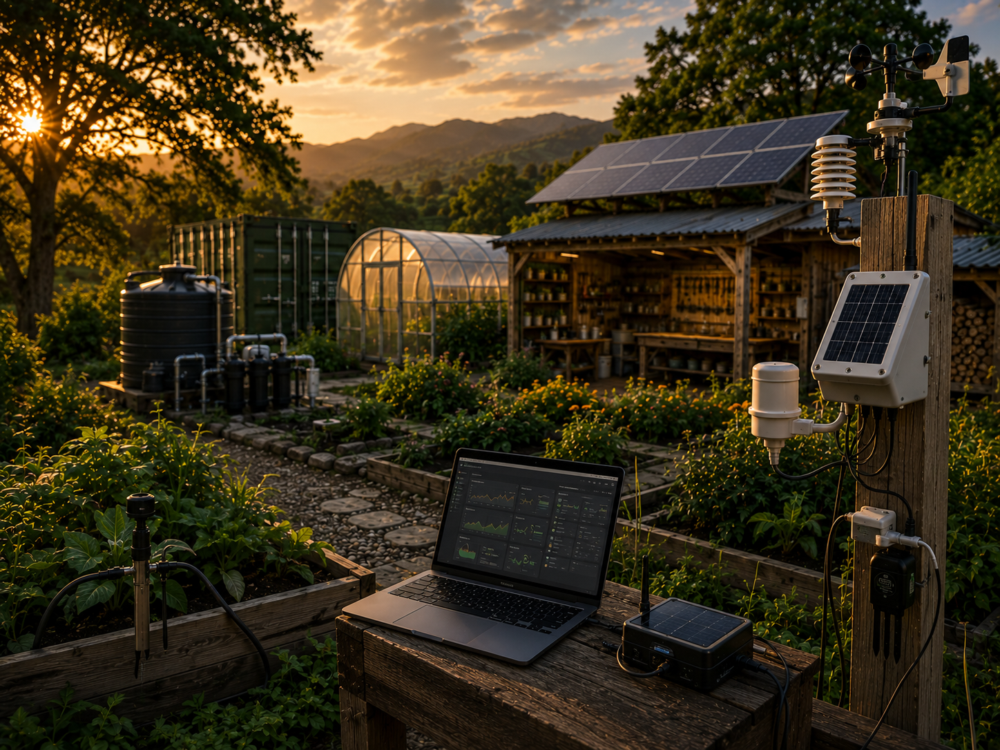

# Metrics

<section class="ew-page-hero" aria-label="Metrics and plant operations">
  
  <div class="ew-page-hero-content">
    <p class="ew-page-hero-kicker">Data layer</p>
    <h1>Metrics & Plant Operations</h1>
    <p>Inventory, telemetry, logs, map context, time-series and comparison views for individual plant assets and field plots.</p>
  </div>
</section>

Metrics is the NMS/CMDB layer for NoMad's Farm.

[Open the Plant Inventory & Metrics App](app.md)

---

## Operational model

```text
network device      -> individual plant / managed plot
hostname            -> display name
PID / model         -> species / cultivar / asset type
serial number       -> stable plant asset ID
site                -> growing location
rack / slot         -> pot / container / bed / pit
interface           -> metric stream
syslog / event log  -> plant observation / action log
telemetry           -> growth + environmental time-series
```

The important rule is simple: **individually managed plants get individual IDs**.

Group assets remain valid only when the thing is actually managed as a group, such as a 10 × 2 m plot, a population, or a 10-pit squash cluster.

---

## Current Pink Dream inventory

```text
Sofia balcony
├── solanum_lycopersicum_pink_dream_01 -> f30_01
├── solanum_lycopersicum_pink_dream_02 -> f30_02
├── solanum_lycopersicum_pink_dream_03 -> f30_03
└── solanum_lycopersicum_pink_dream_04 -> f30_04
```

Known current data:

```text
Pink Dream 01 -> height 65 cm
Pink Dream 02 -> height 60 cm
Pink Dream 03 -> vitals pending
Pink Dream 04 -> planted from branch seedling propagated from Pink Dream 02
```

Each plant has its own log stream in:

```text
../assets/data/plant-asset-logs.json
```

---

## Canonical app data

```text
../assets/data/plant-map-app.seed.json
../assets/data/plant-asset-logs.json
../assets/data/plant-radar-profiles.json
../assets/data/balcony-environment.daily.json
../assets/data/pink-tomatoes.daily.json
../data/balcony-environment.sources.yml
```

The interactive operational UI lives in:

```text
app.md
```

Older monitor pages and historical datasets may remain as reference material, but `metrics/app.md` is the canonical application surface.

---

## Data rules

1. Stable ID per individually managed plant.
2. Stable ID per container, plot, pit cluster and site.
3. Logs belong to the asset that actually experienced the event.
4. Shared events may be recorded against more than one asset when they genuinely affected each one.
5. Raw measurements remain separate from interpretation.
6. Timestamps use ISO format with `Europe/Sofia` offset.
7. Metric units only.
8. Unknown values stay null rather than being guessed, because fiction is cheaper to write and significantly worse to graph.
