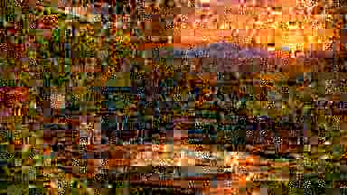

# Metrics App

<section class="ew-page-hero" aria-label="Plant Database">
  
  <div class="ew-page-hero-content">
    <p class="ew-page-hero-kicker">03 · Operations</p>
    <h1>Plant Database</h1>
    <p>Individual plant assets, vitals, logs, topology and map context.</p>
  </div>
</section>

This is the canonical operational app for NoMad's Farm.

```text
site / location
  -> individual plant or plot asset
     -> container / slot
     -> vitals
     -> event logs
     -> environmental interfaces
     -> radar profile
     -> map / topology context
```

Each individually managed plant gets its own stable asset ID and log stream. Group assets are kept only where the real-world object is intentionally managed as a plot, population or pit cluster.

Owner-provided coordinates are used for mapped sites and assets. Plant-level GPS offsets are only visualization offsets inside the same growing location, not centimeter-accurate survey positions.

<div data-ew-metrics-app></div>

---

## App data sources

```text
../assets/data/plant-map-app.seed.json      # inventory, locations, topology, vitals
../assets/data/plant-asset-logs.json        # per-asset event history
../assets/data/plant-radar-profiles.json    # crop/resource comparison profiles
../assets/data/balcony-environment.daily.json
../assets/data/pink-tomatoes.daily.json
../data/balcony-environment.sources.yml
```

---

## Inventory model

```text
Site
├── Plant Asset 01
│   ├── Asset ID / SN
│   ├── Type / PID
│   ├── Container / slot
│   ├── Status
│   ├── Vitals
│   ├── Logs
│   └── Metric interfaces
├── Plant Asset 02
└── Plot / population assets where grouping is intentional
```

Current Pink Dream tomatoes are represented as four independent plant assets, each assigned to its own F30 pot.

---

## Map / overlay model

```text
Base underlay
└── OpenStreetMap

Plant overlays
├── sites
├── individual plant assets
├── field plots / pit clusters
├── vitals
└── topology

Weather context
├── temperature
├── humidity
├── UV index
├── solar radiation
├── precipitation
├── wind
└── pressure

Future overlays
├── growth heatmap
├── water stress heatmap
├── UV stress heatmap
├── humidity risk heatmap
├── pest pressure heatmap
└── yield heatmap
```
